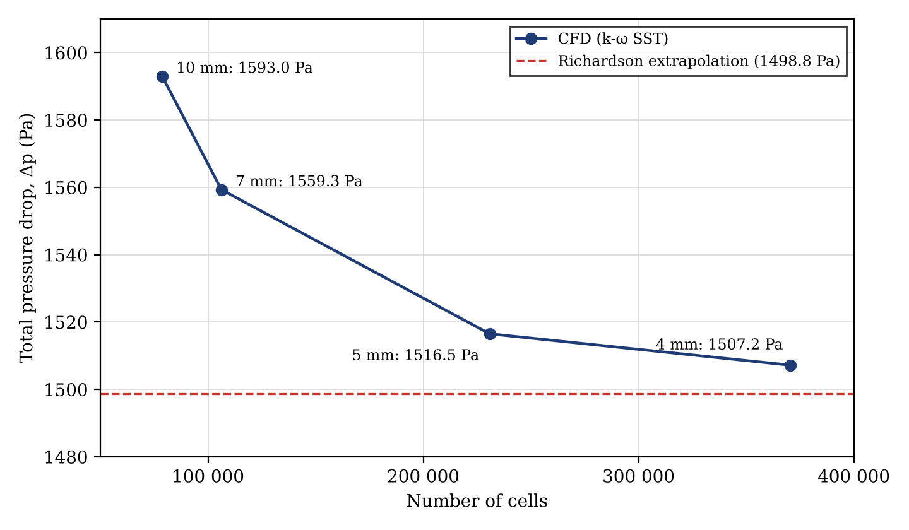
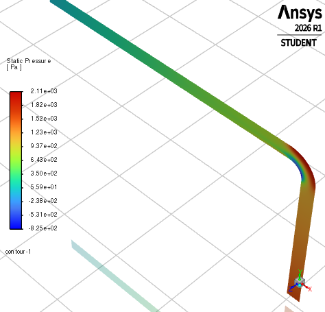
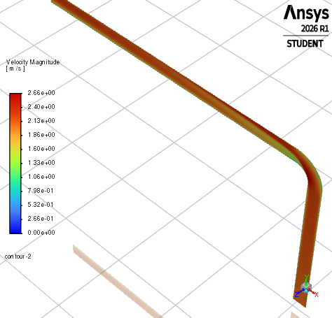
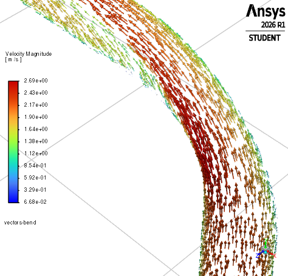

# CFD Analysis of Water Flow Through a 90° Elbow (ANSYS Fluent)

I used ANSYS Fluent to find the pressure drop when water flows through a 90° pipe elbow, ran a mesh independence study, and checked the result against a hand calculation.

**Result:** the total pressure drop is **1507 Pa ± 2%** at 2 m/s. My last mesh refinement changed it by 0.6%, and my hand calculation (1565 Pa) agrees to within 4%.

Full report: [report/elbow_cfd_report.pdf](report/elbow_cfd_report.pdf)



## The problem

| Feature | Value |
| --- | --- |
| Bore (D) | 50 mm |
| Inlet leg | 500 mm, vertical |
| Bend | 90°, centreline radius 75 mm (R/D = 1.5) |
| Outlet leg | 1000 mm, horizontal |
| Fluid | Water, 2 m/s inlet velocity (Re ≈ 100,000) |

## Method

- **Geometry:** fluid volume only, made in SolidWorks by sweeping a 50 mm circle along the pipe centreline, exported as STEP.
- **Mesh:** ANSYS Meshing with tetrahedral cells in the core and 5 inflation layers at the wall (Smooth Transition). I made four meshes: 10, 7, 5 and 4 mm element size.
- **Solver:** Fluent, pressure-based steady, k-ω SST, Coupled scheme, second-order pressure and momentum, residuals to 1×10⁻⁵.
- **Boundary conditions:** velocity inlet 2 m/s (5% turbulence intensity), pressure outlet 0 Pa gauge, no-slip walls.

## Results

### Mesh independence

| Element size | Cells | Pressure drop | Change |
| --- | --- | --- | --- |
| 10 mm | 78,696 | 1593.0 Pa | – |
| 7 mm | 106,218 | 1559.3 Pa | −2.1% |
| 5 mm | 230,857 | 1516.5 Pa | −2.7% |
| **4 mm** | **370,393** | **1507.2 Pa** | **−0.6%** |

Richardson extrapolation on the three finest meshes gives 1498.8 Pa. The GCI is 0.7%, or about 2% if second-order convergence is assumed (I report the conservative value).

### Hand calculation

| Component | Pressure drop |
| --- | --- |
| Straight-pipe friction (Blasius f = 0.0178, L/D = 30) | 1066 Pa |
| Bend loss (K = 0.25) | 499 Pa |
| **Total, hand calculation** | **1565 Pa** |
| **Total, CFD** | **1507 Pa** |

Working backwards from the CFD, the bend's loss coefficient is K ≈ 0.22.

### Flow field (4 mm mesh)

| Static pressure | Velocity magnitude |
| --- | --- |
|  |  |



Pressure is highest on the outer wall of the bend (about 2110 Pa gauge) and lowest on the inner wall (about −825 Pa gauge). The water speeds up along the inner wall of the bend to about 2.7 m/s, around 34% above the mean velocity.

## Repository contents

```
├── report/          Full report (PDF)
├── workbench/       Complete ANSYS Workbench project (all four meshes and solutions)
├── fluent/          Standalone Fluent case and data files for the 10, 7, 5 and 4 mm meshes
├── geometry/        Fluid volume: SolidWorks part and STEP file
├── results/         Mesh independence data (CSV) and chart
└── images/          Contours and vectors (4 mm mesh); other_meshes/ has the 10, 7 and 5 mm plots
```

## Opening the files

You need ANSYS 2026 R1 or newer (the Student version works).

- **Full project:** open `workbench/90_degree_elbow_workbench.wbpj` in ANSYS Workbench. Keep the `.wbpj` file and the `90_degree_elbow_workbench_files` folder together in the same folder, or Workbench will not find the project data. The project has four Fluid Flow (Fluent) systems, one for each mesh.
- **Results only:** in standalone Fluent, read any `fluent/elbow_<size>.cas.h5` file together with its matching `.dat.h5` file (Case & Data), and the converged solution is ready for post-processing.

## Limitations

- The refinement ratios between meshes are not uniform.
- I did not check y⁺, and the near-wall resolution changes between meshes.
- The outlet is 20 diameters after the bend, so the result is for this pipe run, not an isolated elbow.
- Smooth walls, uniform inlet velocity, steady flow.

## Tools

SolidWorks · ANSYS Student 2026 R1 (Workbench, SpaceClaim, Meshing, Fluent)
